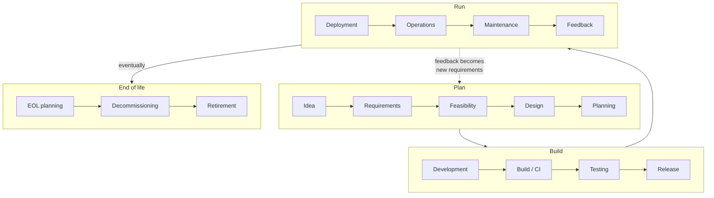

# Why I Built the Cluster: Motivation, Objectives, and the Alternatives I Weighed

*A foundational document. Written after the fact, but describing the reasoning as
it stood when I decided to build.*

## 1. The motivation

The starting point: I'm a CS student in Singapore interested in the domains
of computer systems, networks and graphics. I am primarily gearing towards CDN, SRE, 
and platform-engineering roles, and those roles have a chicken-and-egg problem. 
They want people who've *operated* real infrastructure: GitOps, observability,
distributed storage, ingress, networking. The problem is that you don't get to 
operate real infrastructure until someone hires you into a role that lets you. 
Coursework doesn't fill that gap, neither does a tidy GitHub repo full of toy 
projects that never ran anywhere. 

Over my 2 years as an undergrad in NUS (National University of Singapore),
I have come to realise that the programming in CS isn't exactly the barrier for your projects.
In the age of AI and thousands of projects executed through coursework or hackathons,
you will come to realise what ultimately matters is that your project actually ships and
remains reliable during its lifecycle.

So here comes the question of **how**. To do that, we must first somewhat understand
the development lifecycle of software, from gathering the requirements to deployment
and the monitoring + maintenance that comes after.

As a student, you will typically learn the steps from Ideation all the way to development
and perhaps the steps heading towards deployment. But have you thought about **how** you
will actually serve your products to your "customers"? 

Suppose that you are making a website. Ask yourself these questions:

- How is my website hosted?
- How does the domain name actually send user traffic to the place that hosts the website?
- How is the website backend server actually implemented on the physical device? After all, your server must exist on a physical computer.
- How do we actually reconcile bugs or even service failures during deployments? Or better yet, how do we **anticipate** and **plan** for such cases?

These are questions the average student like me rarely asks, and it is why so many
of our projects end up in the dumpster: there is nowhere to deploy them. Answering
these questions won't happen in a single weekend; it takes a significant amount of time to grasp the IT infrastructure that exists within
our world.

So the cluster exists to manufacture the experience I can't otherwise get. It's a
place to make production-grade mistakes on my own hardware, on my own time, where
the blast radius is my weekend and not a company's SLA. Every hard thing I'd
eventually be expected to know on the job, why a CRD sync fails, how to keep a
database's backups honest, what happens when self-heal fights a manually-edited
secret, I wanted to have already hit, understood, and fixed at least once.

There's a second motivation underneath the career one, which is that I actually
enjoy this. The cluster is a standing invitation to learn Go, to hand-write a
sync protocol, to understand networking from the packet up. The portfolio framing
keeps me honest about scope and sequencing, but the reason I keep coming back to
it on weekends is that it's genuinely interesting to build (this is very important
for not suddenly burning out and drop the project altogether). 

Furthermore, it provides highly available infrastructure to experiment on and, most
importantly, to deploy any projects that you make. This itself would perhaps
give you a sort of understanding and appreciation for the infrastructure that has
been built from the ground-up to make our daily lives possible (and also to give
us CS students a job). You will come to see how many people have contributed towards
the effort, especially in the world of open source, where millions of unpaid contributors
maintain the dependencies that we rely on.

## 2. The objectives

Concretely, I wanted the cluster to demonstrate, and force me to learn the
following, in roughly this order of priority:

- **Container orchestration in practice**, not in theory. A real K3s cluster
  across heterogeneous nodes, with workloads that actually have to be scheduled,
  placed, and kept alive.
- **GitOps as the operating discipline.** Git as the source of truth, ArgoCD
  reconciling the cluster to match, CI building and pushing images. The whole
  `git push -> build -> deploy` loop, with no manual `kubectl` in the critical
  path.
- **Observability that means something.** Prometheus scraping real services,
  Grafana dashboards I actually read, an understanding of the RED method and how
  metrics feed autoscaling, not a default dashboard I imported and forgot.
- **Networking depth.** Reverse proxies and ingress (Traefik), load balancing
  (K3s ServiceLB, plus kube-vip for floating addresses), secure external access
  without opening my router (Cloudflare Tunnel),
  and private remote access to the whole cluster (Tailscale). Eventually
  hand-building an L4/L7 proxy and a custom binary protocol to understand what the
  off-the-shelf tools are doing.
- **Distributed storage.** Longhorn for replicated block storage, ZFS on the
  storage-heavy node for bulk data and backups, and backup and restore paths I have
  actually tested for anything stateful.
- **Real, self-hosted services** running on all of it: a portfolio site, a file-sync
  system (Seafile), and my own hand-written Obsidian sync (obsync).

The meta-objective sitting above all of these: **be able to explain *why* every
choice was made.** A cluster I can't reason about is just a pile of YAML. The
value, to me and to an interviewer, is in the decision log, not the uptime number.

## 3. The alternatives: different ways of acquiring compute

Before committing to owned hardware I did genuinely consider the alternatives.
"Build a homelab" was the answer, but it wasn't the only option, and the reasons
the others lost are part of the justification.

### 3.1 Public cloud (AWS / GCP / Azure)

The obvious default. Spin up managed Kubernetes (EKS/GKE), pay by the hour, never
touch hardware. You might have even learnt this back in school, or played with it
yourselves.

**Why it's attractive:** zero capital outlay, real production-grade networking and
durability, the exact managed services I'd use at work, and instant scale.

**Why it lost, for *this* goal:**

- **Cost shape is exactly wrong for a learning cluster.** A homelab is a *steady,
  always-on, high-utilization* workload, the single worst fit for on-demand cloud
  pricing, which charges a premium precisely so you can scale to zero. I never
  scale to zero; I'd be paying the elasticity premium for elasticity I don't use.
  (The full numbers are in [Cost vs Value](03-cost-value-singapore.md), but the headline is that the AWS-equivalent of my 
  cluster runs roughly **US$11,000+/year**, and my entire hardware build cost about
  a month and a half of that.)
- **The managed layer hides the learning.** EKS *is* the thing I want to
  understand the guts of. If AWS runs the control plane, provisions the storage
  CSI, and manages the ingress, I've learned to *consume* a platform, not
  *operate* one. The whole point is to be the person who runs it.
- **The bill punishes experimentation.** Leaving a GPU node running over a weekend
  because I forgot is a rounding error on my electricity bill and a genuinely
  painful line item on a cloud invoice. Owned hardware makes mistakes cheap, which
  is what a learning environment needs.

Cloud isn't wrong, it's the right tool for spiky, unpredictable, or
scale-out-fast workloads, and I'd reach for it in a heartbeat for a startup's
production traffic. It's just the wrong tool for *sustained self-education on
owned baseline load.*

### 3.2 A single powerful server / one big box

Buy one capable machine, run everything on it (maybe with VMs to fake
multi-node).

**Why it lost:** the entire point is *distributed* systems. Scheduling across
nodes, replica placement, node failure domains, "which node has the GPU,"
draining a node for a reboot, none of which is real on a single box. VMs can
simulate it, but they can't teach me what happens when a physical node overheats
or a laptop's battery-removed worker drops off the network. Heterogeneity and
genuine node independence are features here, not accidents.

### 3.3 Raspberry Pi / ARM SBC cluster

The classic homelab starter: a stack of cheap Pis.

**Why it lost (for the main cluster):**

- **Architecture friction.** My whole pipeline builds `linux/amd64` images to
  ghcr.io. Going ARM means multi-arch builds via `docker buildx`, a real,
  ongoing tax on every image, for no learning benefit relevant to my goals.
- **Underpowered for the real workloads.** Postgres, a
  monitoring stack, dev containers, these want CPU, RAM, and real I/O that a Pi
  struggles with. I'd spend my time fighting resource limits instead of learning
  platform patterns.

It is also worth noting that almost every single piece of software that you use
or integrate is compatible with x86. The same cannot be guaranteed for ARM.
That is a big part of why the first iteration of the Snapdragon Windows laptops 
flopped rather badly in the market.

*(Worth noting: I kept a Pi cluster on the table as a **separate** project for
CS3210 parallel-computing coursework, OpenMP/MPI compiled from source, where the
arch concern disappears entirely. Different tool, different job.)*

### 3.4 Free-tier / student-credit cloud

Stretch AWS/GCP free tiers and student credits as far as they go.

**Why it lost:** credits run out, and they run out *fastest* on exactly the
always-on compute a homelab needs. The moment the credits lapse I'm back to the
cloud cost problem, except now my "learning environment" has a countdown timer on
it. It's a way to *try* cloud, not to *live* in an always-on cluster.

### 3.5 VPS fleet (cheap providers)

Rent several cheap VPSes and cluster them.

**Why it lost:** it's a middle ground that gets the worst of both. Still a
recurring bill (smaller, but forever), still someone else's virtualized hardware
so I don't learn the physical/node layer, and networking between providers is
its own headache. The one place a cheap VPS *did* earn a role was as a potential
WireGuard *relay*, a single tiny box for NAT traversal, which is a narrow,
well-scoped use, not a home for the cluster.

### 3.6 Owned hardware: the choice

What I actually did: three heterogeneous always-on x86 nodes (a Lenovo M910q
control plane, an i7-6700K desktop with a GTX 1080 doubling as the NAS, and a
battery-removed laptop worker with a GTX 1060). Two more mini PCs joined in August
2026 as extra control-plane nodes, making five.

**Why it won:**

- **The cost shape fits.** Capital cost paid once, then only electricity, and at
  Singapore tariffs that's a small monthly number for an always-on learning rig.
- **Hardware availability.** This kind of used and custom hardware is rather easy
  to obtain at a reasonable price in Singapore.
- **I own every layer.** From the physical node and the OS up through K3s, 
  storage, networking, and the apps, nothing is hidden behind a managed
  abstraction. That's the entire pedagogical value.
- **Mistakes are cheap**, so I experiment freely. Freedom is worth every single
  penny.
- **It's a genuine learning experience.** "I ran a multi-node K3s platform with
  GitOps, distributed storage, observability, and custom networking on my own
  hardware for months" is a concrete valuable project, especially if you can 
  genuinely reason about it.

## 4. The honest caveat

Owning the hardware is the right call *for this goal specifically*, but it is not
apples-to-apples with the cloud, and I want to be clear-eyed about that. AWS
bundles redundancy, 25Gbit networking, managed durability, and the absence of me
crawling behind a desk at 3am because a MoCA link is flapping or some sync error
in ArgoCD is preventing the deployment from being updated. I'm not paying the cloud 
premium because, for a learning cluster, I don't need any of what it buys, and 
needing to learn all of that *myself* is the feature. If this were production
traffic with real users and an SLA, the calculus would flip. The cluster is the
right answer to "how do I learn to operate infrastructure," not to "how should a
business run its workloads." Those are different questions, and keeping them
separate is itself part of what I set out to understand.
