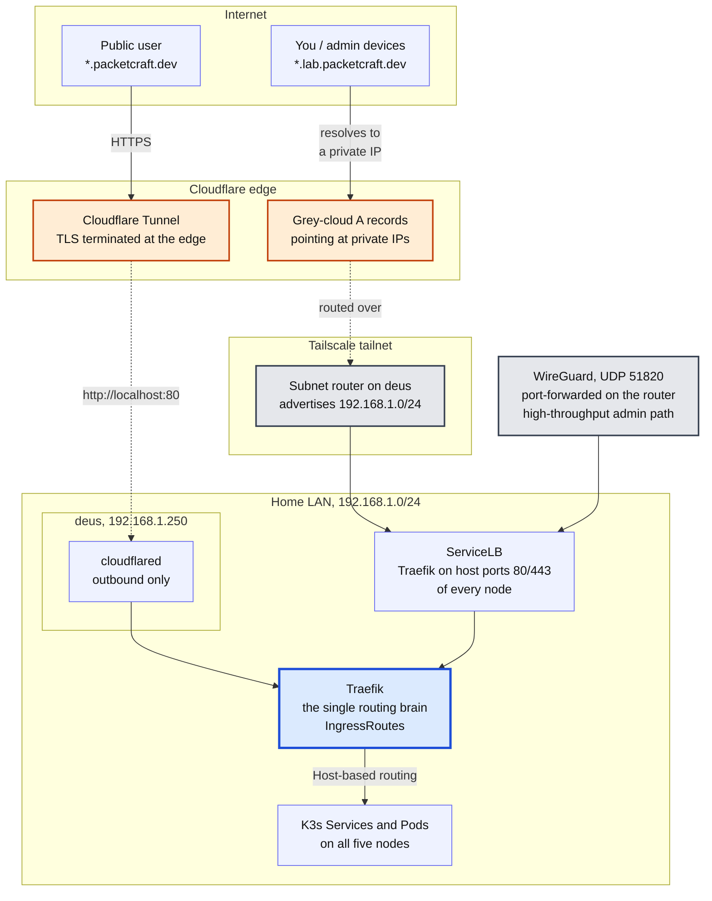
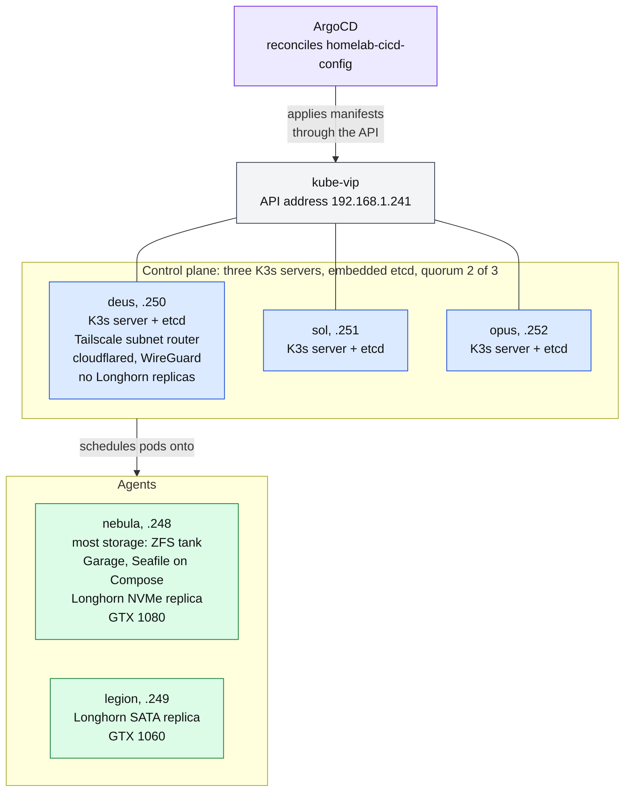
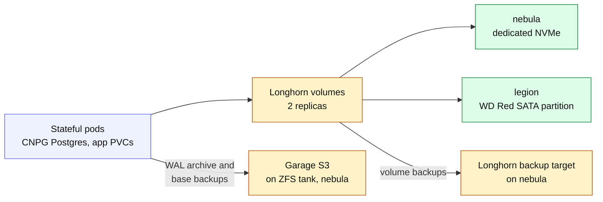
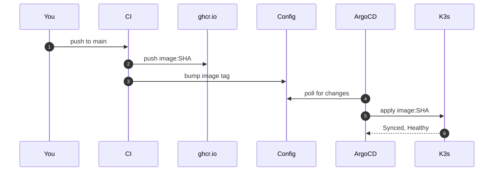
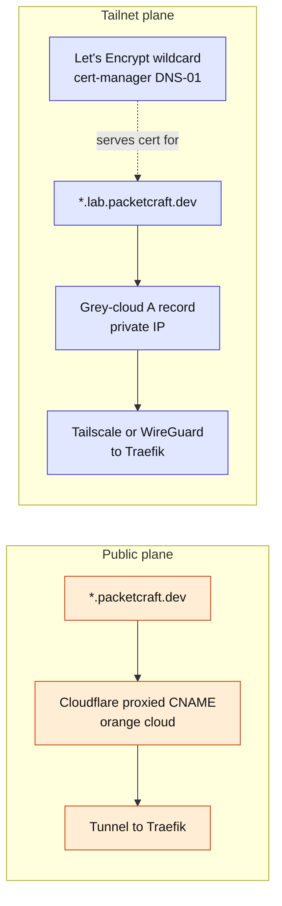

# Homelab Kubernetes Platform: Architecture

A five-node K3s cluster running GitOps-managed services, with a split public/tailnet
ingress model and Longhorn distributed storage. Three of the nodes are K3s servers
sharing an embedded etcd datastore. This document captures the network topology (how
traffic reaches the cluster) and the internal cluster topology (how workloads,
storage, and GitOps fit together).

**Domains:** `*.packetcraft.dev` (public, via Cloudflare Tunnel) · `*.lab.packetcraft.dev` (tailnet-only)
**Source of truth:** `BarneyLaw/homelab-cicd-config` (GitHub) → ArgoCD

---

## 1. Node inventory

| Node | Hardware | IP | Role | Notable duties |
|------|----------|-----|------|----------------|
| **deus** | Lenovo M910q, i7-6700T | `192.168.1.250` | K3s server + etcd member | cloudflared, WireGuard, Tailscale subnet router; **no Longhorn replicas** (thermal) |
| **sol** | Intel NUC, i5-10210U, 16GB | `192.168.1.251` | K3s server + etcd member | Provisioned with Ansible; also schedules workloads |
| **opus** | HP EliteDesk 800 G4 Mini, i5-8500 | `192.168.1.252` | K3s server + etcd member | Provisioned with Ansible; also schedules workloads |
| **nebula** | i7-6700K desktop | `192.168.1.248` | Agent (worker) | Most storage in the cluster: ZFS `tank`, Garage (S3 backup store), Seafile (Compose), GTX 1080, Longhorn NVMe replica |
| **legion** | Laptop (battery removed) | `192.168.1.249` | Agent (worker) | Longhorn SATA replica (`/var/lib/longhorn-disk-sda`) |

> Every node runs 24/7. `legion` is a permanent node, not a transient or Wake-on-LAN worker.

### 1.1 Control plane

Until the end of August 2026 the cluster had a single K3s server (deus) and two
agents. With only one server, K3s quietly uses an embedded **SQLite** datastore,
which I had not actually realised until I tried to add more servers. SQLite cannot
back a cluster with multiple servers, so adding sol and opus meant migrating the
datastore to **embedded etcd** first. K3s supports this in place: restart the
existing server with `--cluster-init`, then join the new servers with `--server`
pointing at it. The whole thing was done through Ansible so the next node is a
playbook run rather than an afternoon.

What the cluster looks like now:

- **Three servers, one etcd cluster.** deus, sol and opus each run the API server,
  scheduler, controller manager and an etcd member inside the single `k3s` process.
  Quorum is 2 of 3, so the cluster survives losing any one server. It does **not**
  survive losing two, and while one server is down for maintenance there is no
  margin left at all.
- **An odd number on purpose.** Two servers would be worse than one: an etcd cluster
  of two needs both members for quorum, so either failing stops writes.
- **A floating API address.** kube-vip holds `192.168.1.241` on whichever server is
  currently leader, and kubeconfigs point at that address instead of a single node.
  The VIP has to be listed in the servers' `--tls-san` or `kubectl` rejects the
  certificate.
- **Agents.** nebula and legion run only the kubelet, container runtime and flannel.
  Their built-in client-side load balancer keeps connections open to all three
  servers.
- **Ports that must be open between servers.** TCP 2379-2380 for etcd peer traffic,
  TCP 6443 for the API, UDP 8472 for flannel VXLAN, TCP 10250 for the kubelet. A
  firewall silently blocking 2380 on deus was one of the two faults in the
  September control-plane outage.

---

## 2. Network topology

How the two ingress planes (public + private) reach a single Traefik routing brain.

**Two ingress pipes, one brain.** Cloudflare Tunnel (public, outbound-only, no open ports)
and Tailscale/WireGuard (private) are *dumb pipes*. All routing logic lives in Traefik
IngressRoutes. This is the single-routing-brain principle: per-app proxies are scoped to
their own stack and never become a second general-purpose ingress.

| Access path | Domain | TLS | Reaches |
|-------------|--------|-----|---------|
| Cloudflare Tunnel | `*.packetcraft.dev` | Cloudflare edge cert | Public services |
| Tailscale subnet router | `*.lab.packetcraft.dev` | Let's Encrypt wildcard (cert-manager DNS-01) | Tailnet-only services |
| WireGuard (UDP 51820) | private IPs | N/A | High-throughput admin path |

**How traffic reaches Traefik on the LAN.** Traefik is a `LoadBalancer` Service, and
the ServiceLB controller bundled with K3s satisfies it without any external load
balancer. ServiceLB runs a small `svclb` pod on each eligible node that binds the
Service ports (80 and 443) as host ports and forwards them to Traefik, so every
node's own IP answers on 80 and 443. There is no address pool to manage. Since
September, kube-vip also holds `192.168.1.242` as one shared address for the lab
plane, carried by one control node at a time, so lab DNS records can point at a
single address instead of at a specific node.

---

## 3. Internal cluster topology

Node roles and how the control plane fits together. Storage and observability follow as separate diagrams so each one stays readable.

### 3.1 Storage and backup paths

### 3.2 Observability

- **kube-prometheus-stack** (Prometheus, Alertmanager, Grafana) scrapes every node's
  node-exporter plus Traefik, Longhorn, CNPG, cert-manager and ArgoCD, each with its
  own dashboard stored as a ConfigMap in Git.
- **nvidia_gpu_exporter** runs on nebula and is pulled in through a `ScrapeConfig`.
- **Known blind spot:** etcd itself is not scraped yet (see section 7).

---

## 4. GitOps deployment flow

The `git push → build → deploy` loop that stands up every built-from-source service.

- **CI** is GitHub Actions in the app repo. It writes to the config repo with a
  fine-grained PAT (Contents read and write) and has no access to the cluster.
- **ArgoCD** polls `homelab-cicd-config` roughly every three minutes, since the GitHub
  webhook is not set up yet.
- **selfHeal** reverts manual drift and **prune** removes resources deleted from Git.

**Two-repo split.** CI writes to the config repo; ArgoCD reads from it. They never talk
directly, a single repo would loop (CI's write-back re-triggers CI). Off-the-shelf images
(Grafana, Jellyfin) skip CI entirely: just an `apps/<svc>/` manifest + ArgoCD Application.

---

## 5. Key architectural principles

- **Let K3s manage as much as it can.** The aim is for the cluster to run and reconcile everything from Git, not to split ownership between K3s and a NAS. nebula is simply the node with the most storage: it holds the ZFS `tank` pool and is the backup path for most deployments (CNPG WAL archives and base backups go to Garage on `tank`, and the Longhorn backup target sits on nebula too). Seafile still runs under Docker Compose on nebula for now. Jellyfin placement remains open (the GTX 1080 is on nebula).
- **Cloudflare Tunnel = dumb pipe, Traefik = routing brain.** All routing logic in IngressRoutes; ingress pipes just feed it.
- **Single routing brain.** Per-app proxies stay scoped to their stack, never a second general-purpose ingress.
- **Longhorn cannot use ZFS.** Needs a dedicated disk formatted ext4/XFS at a stable mount, `multipathd` blacklisted. 2 replicas = the floor for node-independent redundancy.
- **`selfHeal` + Helm-managed secrets = churn.** Chart-owned credentials get reset on reconcile → migrate to `existingSecret` + SealedSecret.
- **Sealed Secrets key backup is critical.** Losing the controller private key makes all sealed secrets unrecoverable.
- **Ansible below K3s, ArgoCD in-cluster.** The two layers must not overlap.

---

## 6. Split DNS / TLS model

---

## 7. Known gaps & horizon

**Open drift / gaps**
- Grafana `lab.` IngressRoute still hand-applied → move to `apps/monitoring-extras/`
- Grafana admin password → SealedSecret migration pending
- GitHub webhook for push-triggered ArgoCD sync not yet configured (currently poll-based)
- Renovate not yet set up
- code-server ambient credential leak fix deferred

**On the horizon**
- **Portfolio site** (static + Go API + Postgres): first real app, before obsync
- **obsync** (Go backend + Postgres, both in K3s): deferred to avoid layering Go + Postgres + custom protocol at once
- **etcd visibility**: K3s does not expose etcd metrics by default (`--etcd-expose-metrics` is false) and the kube-prometheus-stack etcd job looks for etcd pods that do not exist under K3s, so losing a member currently alerts nobody
- **Taint deus**: it carries the most cluster-critical roles and should stop taking general workloads
- **Longhorn backup target**: NFS share on nebula's `tank`, to configure before any DB holds real data